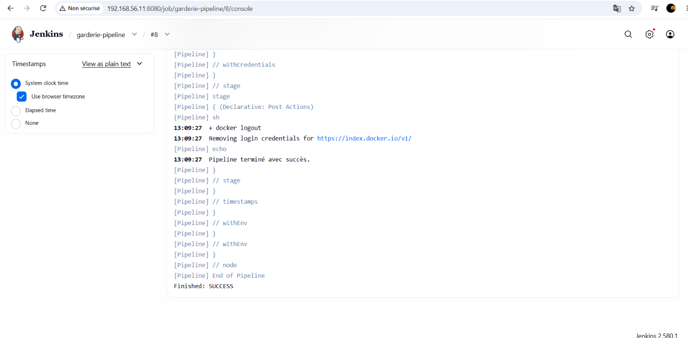
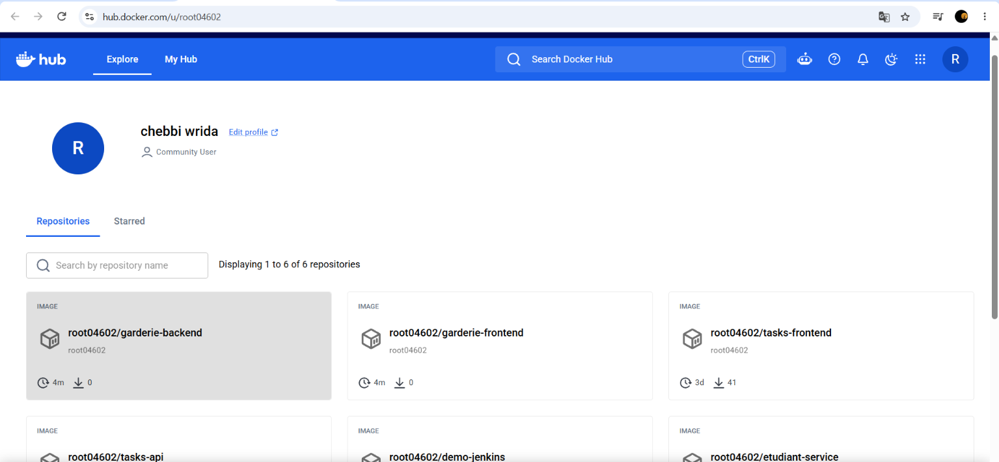
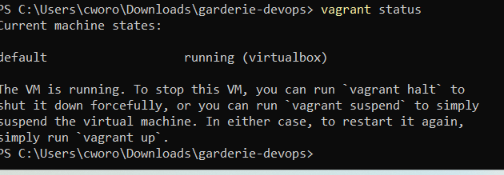
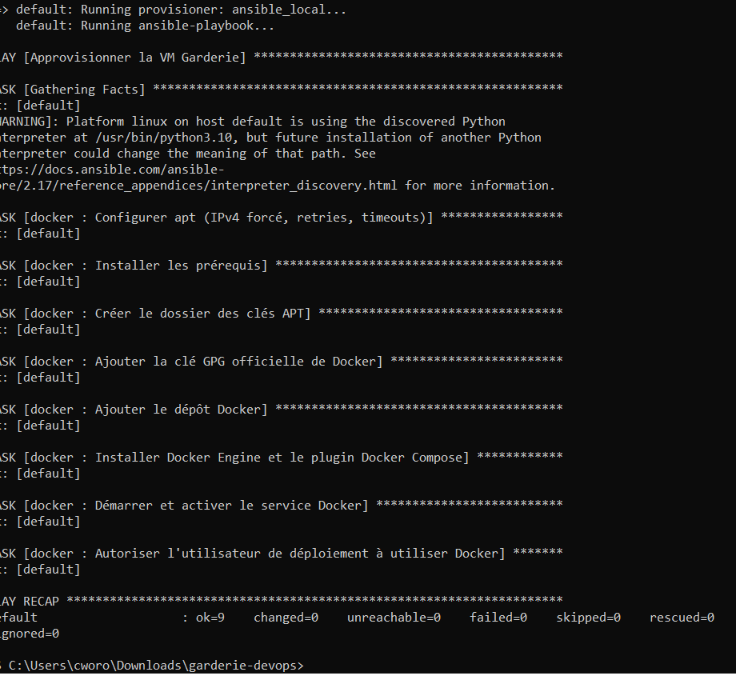
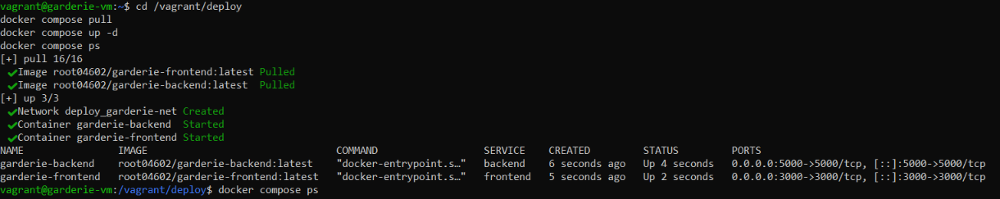
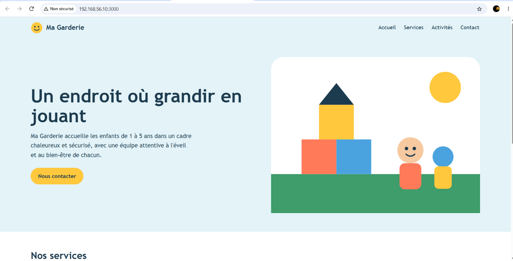

# Ma Garderie — Chaîne CI/CD DevOps

Application web d'une garderie d'enfants, livrée par une chaîne complète : **GitHub → Jenkins → Docker Hub → VM Vagrant (provisionnée par Ansible) → Docker Compose**.

## 1. Présentation et technologies

| Couche | Technologie |
|---|---|
| Frontend | Next.js 14 (React 18), composants Navbar, Hero, Services |
| Backend | Node.js 20, Express (3 API REST) |
| Tests | Jest + Testing Library |
| Conteneurs | Docker, Docker Compose |
| CI/CD | Jenkins (Pipeline as Code) |
| Infrastructure | Vagrant (VirtualBox, Ubuntu 22.04), Ansible |

API REST du backend :

- `GET /api/garderie` : informations générales
- `GET /api/services` : liste des services
- `GET /api/activites` : liste des activités

## 2. Architecture

```
Navigateur ──► Frontend Next.js :3000 ──/api/*──► Backend Express :5000
                (réseau Docker garderie-net)
```

Le navigateur appelle `/api/*` sur le frontend. Une route API Next.js relaie la requête vers le backend (`BACKEND_URL=http://backend:5000`). Le frontend marche donc depuis n'importe quelle machine du réseau.

Chaîne CI/CD :

```
GitHub ─► Jenkins : Checkout → Install → Test → Build Front → Build Back → Push Front → Push Back ─► Docker Hub
                                                                                                        │
VM Vagrant (Ubuntu, 192.168.56.10) ◄── Ansible (rôle docker) ── docker compose pull/up ◄───────────────┘
```

Arborescence :

```
.
├── backend/            API Express + Dockerfile
├── frontend/           Next.js + test + Dockerfile
├── deploy/             docker-compose.yml (images Docker Hub)
├── ansible/            inventory.ini, site.yml, roles/docker
├── docker-compose.yml  développement local (build)
├── Jenkinsfile
├── Vagrantfile
└── screenshots/
```

## 3. Lancer en local

```bash
docker compose up --build
# Frontend : http://localhost:3000   Backend : http://localhost:5000/api/garderie
```

Test automatisé : `cd frontend && npm install && npm test`

## 4. Création et provisioning de la VM

Prérequis : VirtualBox et Vagrant.

```bash
vagrant up              # crée la VM et lance le playbook Ansible
vagrant ssh             # vérifier l'accès SSH
docker --version && docker compose version   # dans la VM
```

Caractéristiques : Ubuntu 22.04, 2 Go de RAM, 2 vCPU, IP privée `192.168.56.10`.
Pour rejouer Ansible : `vagrant provision`.

Le rôle `ansible/roles/docker` installe Docker Engine et le plugin Compose, démarre et active le service, et ajoute l'utilisateur `vagrant` au groupe `docker`.

## 5. Pipeline Jenkins

1. Installer les plugins **Pipeline**, **Git**, **NodeJS**, **Credentials Binding**. Docker doit être installé sur l'agent, et l'utilisateur `jenkins` doit être dans le groupe `docker`.
2. *Manage Jenkins > Tools* : ajouter une installation NodeJS nommée `node20`.
3. *Manage Jenkins > Credentials* : ajouter un « Username with password » d'ID `dockerhub-credentials` (utilisateur Docker Hub + access token).
4. Créer un job **Pipeline**, option « Pipeline script from SCM », dépôt GitHub, branche `main`, chemin `Jenkinsfile`.
5. Lancer **Build Now**. Un test frontend en échec arrête le pipeline avant les builds Docker.

## 6. Images Docker Hub

- Frontend : https://hub.docker.com/r/root04602/garderie-frontend
- Backend : https://hub.docker.com/r/root04602/garderie-backend

## 7. Déploiement avec Docker Compose (dans la VM)

```bash
vagrant ssh
cd /vagrant/deploy
cp .env.example .env        # renseigner DOCKERHUB_USER
docker compose pull
docker compose up -d
docker compose ps
curl http://localhost:5000/api/garderie
curl http://localhost:5000/api/services
curl http://localhost:5000/api/activites
```

Aucune image n'est reconstruite : elles viennent de Docker Hub.

## 8. Accès à l'application

Depuis une autre machine du réseau : **http://192.168.56.10:3000**

## 9. Captures d'écran

| Capture | Fichier |
|---|---|
| Pipeline Jenkins réussi |  |
| Images sur Docker Hub |  |
| VM démarrée avec Vagrant |  |
| Playbook Ansible réussi |  |
| Conteneurs en cours d'exécution |  |
| Application dans le navigateur |  |
